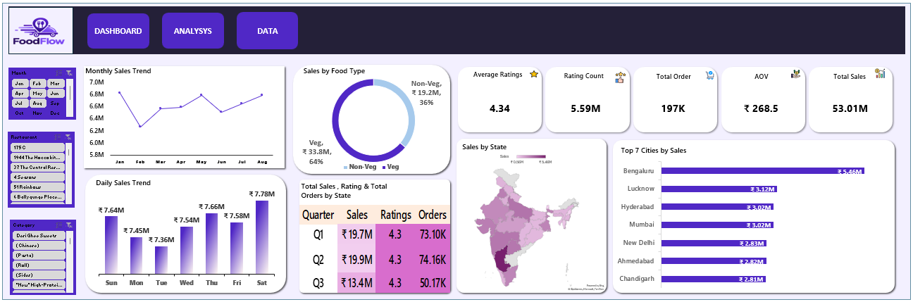

# Food-Flow-Sales-Dashboard-Excel

An interactive end-to-end **Food Delivery Sales & Performance Analysis Dashboard** built in Microsoft Excel. Analyzing **197,430+ food delivery orders** across India (sourced from Swiggy order data), this project uncovers revenue growth patterns, customer rating distributions, dietary preferences (Veg vs. Non-Veg), and top-performing states and cities.

---

## 📌 Project Overview

The goal of this project is to transform raw transactional food-delivery data into an executive-ready, dynamic Excel dashboard that enables stakeholders to monitor business KPIs and filter performance across time, geography, restaurant, and food categories.

### 🔑 Key Performance Indicators (KPIs)
* **Total Sales:** ₹53.01M
* **Total Orders:** 197K (197,430 records)
* **Average Order Value (AOV):** ₹268.50
* **Average Customer Rating:** 4.34 / 5.0
* **Total Rating Count:** 5.59M

---

## 📊 Workbook Structure & Dashboard Features

The Excel workbook (`Food flow Sales Project.xlsx`) is organized into four clean, interconnected tabs:
1. **`DASHBOARD`** – Executive view featuring KPI cards, interactive slicers, custom navigation buttons (`DASHBOARD`, `ANALYSIS`, `DATA`), and dynamic charts.
2. **`ANALYSIS`** – Backend summary tables and 8 multi-dimensional Pivot Tables driving the dashboard visuals.
3. **`Food_Flow_Data`** – Cleaned master dataset (`Swiggy_Data`, `197,430 rows × 14 columns`) with engineered date and category attributes.
4. **`Pivot Calculation`** – Supporting calculation layer for dynamic metrics such as AOV and aggregated KPIs.

### 📈 Visualizations Included
* **Monthly Sales Trend:** Tracks revenue progression from January through August.
* **Quarterly Performance:** Compares Sales, Orders, and Ratings across `Q1`, `Q2`, and `Q3`.
* **Daily & Weekly Sales Trends:** Evaluates order volume and revenue across days of the week (`Sun`–`Sat`) and weekly intervals.
* **Sales by Food Type:** Compares **Veg** (₹33.84M / ~63.8%) vs. **Non-Veg** (₹19.17M / ~36.2%) revenue contribution.
* **Sales by State (Map & Summary):** Geographical breakdown of Total Sales, Average Rating, and Total Orders across Indian states.
* **Top 7 Cities by Sales:** Highlights leading urban markets including Bengaluru, Lucknow, Hyderabad, Mumbai, New Delhi, Ahmedabad, and Chandigarh.

### 🎛️ Interactive Slicers
* **State**
* **Month (Order Date)**
* **Restaurant Name**
* **Food Category**

---

## 🗂️ Dataset Schema (`Food_Flow_Data`)

| Column Name | Description |
| :--- | :--- |
| `State` | Indian state where the order was placed |
| `City` | City of the restaurant/order |
| `Order Date` | Date of the transaction |
| `Day` / `Week` / `Quarter` | Engineered time-intelligence columns for trend analysis |
| `Restaurant Name` | Name of the restaurant fulfilling the order |
| `Location` | Neighborhood / locality within the city |
| `Category` | Menu category (e.g., Recommended, North Indian, Snacks, Chinese) |
| `Dish Name` | Specific food item ordered |
| `Food Type` | Dietary classification (`Veg` or `Non-Veg`) |
| `Price (INR)` | Order item price in Indian Rupees |
| `Rating` | Customer rating score (out of 5) |
| `Rating Count` | Number of user ratings recorded |

---

## 🛠️ Tools & Excel Techniques Used
* **Data Cleaning & Structuring:** Standardized columns and formatted the dataset as a structured Excel Table (`Swiggy_Data`).
* **Feature Engineering:** Extracted `Day`, `Week`, and `Quarter` from `Order Date`, and segmented dishes into `Veg` and `Non-Veg`.
* **Pivot Tables & Pivot Charts:** Built 8 interconnected Pivot Tables for multi-dimensional aggregation.
* **Interactive Slicers & Report Connections:** Linked slicers across all Pivot Tables for synchronized filtering.
* **UI/UX Design:** Added custom navigation buttons, clean layout grids, and formula-linked KPI cards.

---

## 🚀 How to Use This Project
1. Click on **`Food flow Sales Project.xlsx`** in this repository and select **Download raw file**.
2. Open the workbook in **Microsoft Excel (2016 or later / Microsoft 365)** so slicers and map charts render properly.
3. Navigate to the **`DASHBOARD`** sheet and use the slicers to filter by State, Month, Restaurant, or Category.

---

## 👨‍💻 Author
**Name:** Soumya Ranjan Bhola  
**Project:** Food-Flow-Sales-Dashboard   
**Email:** soumyaranjan0359@gmail.com  
**Linkedin:** www.linkedin.com/in/bsoumyaranjan
